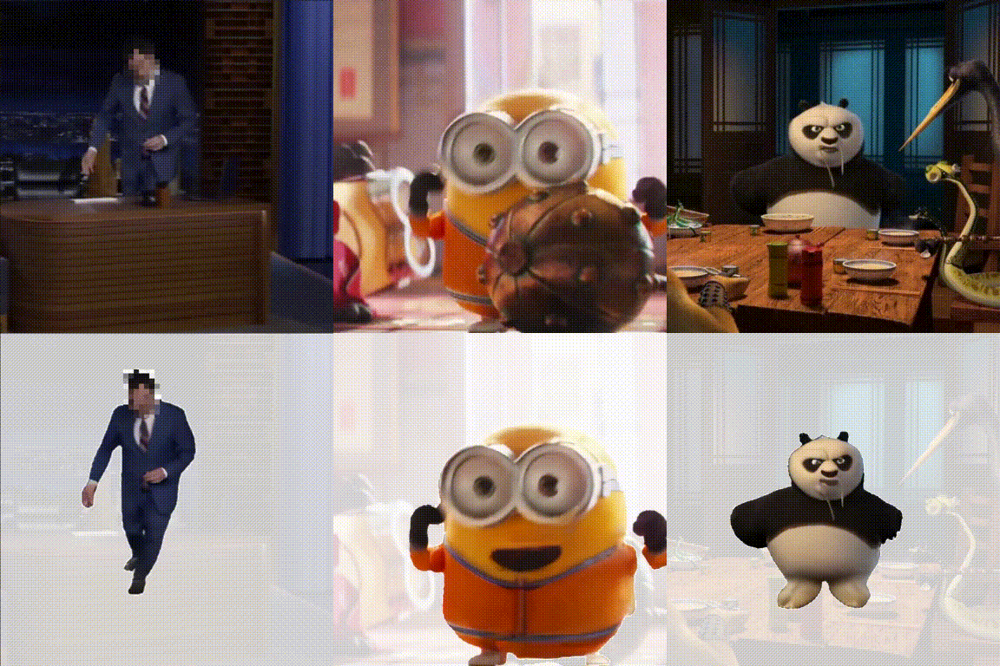

# TACO: Taming Diffusion for in-the-wild Video Amodal Completion

This repository contains the official implementation for [TACO: Taming Diffusion for in-the-wild Video Amodal Completion](https://arxiv.org/abs/2503.12049)

### [Project Page](https://jason-aplp.github.io/TACO/)  | [Paper](https://arxiv.org/abs/2503.12049) | [Weights](https://huggingface.co/datasets/JasonAplp/TACO/tree/main/checkpoints) | [Dataset](https://huggingface.co/datasets/JasonAplp/TACO/tree/main)
<p align="center">
    
</p>

## Install

```bash
conda create -n taco python=3.10
conda activate taco
conda install pytorch torchvision torchaudio pytorch-cuda=12.1 -c pytorch -c nvidia
pip install git+https://github.com/OpenAI/CLIP.git
pip install git+https://github.com/Stability-AI/datapipelines.git
pip install -r requirements.txt
```

## Single-example inference

Download the checkpoint and put it under `checkpoints`

We provide pre-processed examples under `examples`. If you want to use your own example, we recommend using ffmpeg for getting frames and [SAM2](https://github.com/facebookresearch/sam2) for getting the visible masks throughout the video. Consider using the script `segment_ui.py` provided by [Yu Liu](https://yuliu-ly.github.io/) for a user-friendly UI. Placing the script under the repository of SAM2 should be fine.
```bash
cd TACO-model
bash infer_single.sh
```
If you want to use the autonomous driving checkpoint with a different resolution.
```bash
bash infer_single_drive.sh
```
The checkpoints for normal videos (384x384) and autonomous driving (640x384) should be [last.ckpt](https://huggingface.co/datasets/JasonAplp/TACO/blob/main/checkpoints/last.ckpt) and [drive_last.ckpt](https://huggingface.co/datasets/JasonAplp/TACO/blob/main/checkpoints/drive_last.ckpt) respectively.

We highly recommend choosing a large number for the `num_samples` parameter in the script and the results will be saved under the `/output` folder. Choose the most reasonable one after sampling multiple times, the results possess diversity and may not be very stable.

## Dataset inference
Download [OvO Dataset](https://huggingface.co/datasets/JasonAplp/TACO/tree/main/benchmarks) and [Kubric Dataset](https://huggingface.co/datasets/JasonAplp/TACO/tree/main/benchmarks) for benchmarking. 

```bash
bash infer_kubric.sh
bash infer_OvO.sh
```
You should revise the dataset path in the `configs/inference_vac_kubric.yaml` and `configs/inference_vac_OvO.yaml` file (`data/params/dset_root`) before running the inference script.

The results will be saved under the `/output` folder with name like `{folder_name}_{sample_id}` (For example, you should see a subfolder with name `0000_0` for the Kubric benchmark.) By default, we will save amodal rgb images along with a concatentated image containing both the origin rgb image and the amodal rgb image. 


## Training
First, download the following available Stable Video Diffusion checkpoints: [SVD (14 frames)](https://huggingface.co/stabilityai/stable-video-diffusion-img2vid/blob/main/svd.safetensors) and place it under the `pretrained` folder. We use the 14-frame version to save computational resources.

Download the dataset [OvO_Easy](https://huggingface.co/datasets/JasonAplp/TACO/tree/main/OvO_Easy), [OvO_Hard](https://huggingface.co/datasets/JasonAplp/TACO/tree/main/OvO_Hard), [OvO_Drive](https://huggingface.co/datasets/JasonAplp/TACO/tree/main/OvO_Drive) and the corresponding path files, [Easy_train.json](https://huggingface.co/datasets/JasonAplp/TACO/blob/main/Easy_train.json) and [Easy_val.json](https://huggingface.co/datasets/JasonAplp/TACO/blob/main/Easy_val.json) for the OvO_Easy dataset for example. Unzip all the files. The data structure should be:
```
OvO_Easy/
    MVImgNet/
        0/
        1/
        ...
    SA-V/
        sav_000/
        sav_001/
        ...
Easy_train.json
Easy_val.json
```
Run training script:
```bash
bash train.sh
```
You should revise the parameters in the script accordingly including `data.params.dset_root`, `data.params.train_path` and `data.params.val_path` before running the training script. 

Note that this training script is set for an 8-GPU system, each with 80GB of VRAM. If you have smaller GPUs, consider using smaller batch size and gradient accumulation to obtain a similar effective batch size. If you want to debug to make sure everything is fine, please consider using the following script:
```
bash debug.sh
```
This should be fine with only one GPU.

If you want to continue training from the latest checkpoint, please consider using the following script:
```
bash train_continue.sh
```

We also provide the version for `OvO_Drive` training with a different resolution:
```
bash train_drive.sh
```

## Acknowledgement
This repository is based on [Generative Camera Dolly](https://github.com/basilevh/gcd). We would like to thank the authors of these work for publicly releasing their code.

## Citation
```
@article{lu2025taco,
  title={Taco: Taming diffusion for in-the-wild video amodal completion},
  author={Lu, Ruijie and Chen, Yixin and Liu, Yu and Tang, Jiaxiang and Ni, Junfeng and Wan, Diwen and Zeng, Gang and Huang, Siyuan},
  journal={arXiv preprint arXiv:2503.12049},
  year={2025}
}
```